# seggnosis 0.6.0 -- validation report

Generated 2026-10-10 on Linux / Python 3.12.3 (benchmarks run against the repository checkout; the user simulation runs against the *installed wheel*).

> **Read this first.** Every benchmark below uses a *synthetic* segmentation task (32x32 images of overlapping shapes) with a small CNN trained on CPU. That makes ground truth available -- including which pixels are irreducibly ambiguous -- which is what lets us test whether the library's numbers are *meaningful*. It does **not** prove performance on real medical or natural images. See *What this does NOT show* at the end.

## Scoreboard

| Area | Criteria passed | Figure |
|---|---|---|
| Uncertainty quality (mc_dropout / tta / ensemble) | 9/9 | [figure](images/uncertainty_examples.png) |
| OOD detection (Mahalanobis) | 8/8 | [figure](images/ood_auroc_vs_severity.png) |
| Calibration (temperature scaling) | 6/6 | [figure](images/calibration_reliability.png) |
| Conformal prediction (LAC / APS / RAPS) | 3/3 | [figure](images/conformal_coverage_and_size.png) |
| Fixes vs. the PyPI release v0.2.1 | 7/7 | [figure](images/improvement_old_vs_new.png) |
| User simulation (fresh install of the built wheel) | 15/15 | [scenarios](user_simulation/scenarios.md) |

The pass/fail thresholds are listed under each section; they are the author's choices, stated up front, not tuned to the results. A FAIL is a finding, not an error.

## 1. Does uncertainty track real errors?

80 held-out test images, 81,920 pixels. 'Error AUROC' = how well a pixel's uncertainty separates wrong pixels from right ones (0.5 = useless, 1.0 = perfect). 'Ambiguity AUROC' = how well it finds the pixels whose labels are randomly assigned by construction (shape overlaps + label noise) -- errors no model could avoid.

| method | uncertainty | Error AUROC | Ambiguity AUROC | accuracy: most -> least certain quartile | image confidence vs accuracy (Spearman) |
|---|---|---|---|---|---|
| mc_dropout (default) | entropy | 0.921 | 0.907 | 100.0% -> 86.3% | +0.33 |
| mc_dropout | variance | 0.895 | 0.876 | 100.0% -> 86.8% | +0.20 |
| mc_dropout | mutual_information | 0.867 | 0.850 | 100.0% -> 88.0% | +0.06 |
| tta | entropy | 0.920 | 0.906 | 100.0% -> 86.1% | +0.29 |
| tta (default) | variance | 0.883 | 0.849 | 100.0% -> 87.6% | +0.13 |
| tta | mutual_information | 0.812 | 0.741 | 99.9% -> 90.0% | +0.11 |
| ensemble | entropy | 0.925 | 0.928 | 100.0% -> 87.3% | +0.43 |
| ensemble | variance | 0.919 | 0.924 | 100.0% -> 87.5% | +0.53 |
| ensemble (default) | mutual_information | 0.910 | 0.916 | 100.0% -> 87.8% | +0.42 |

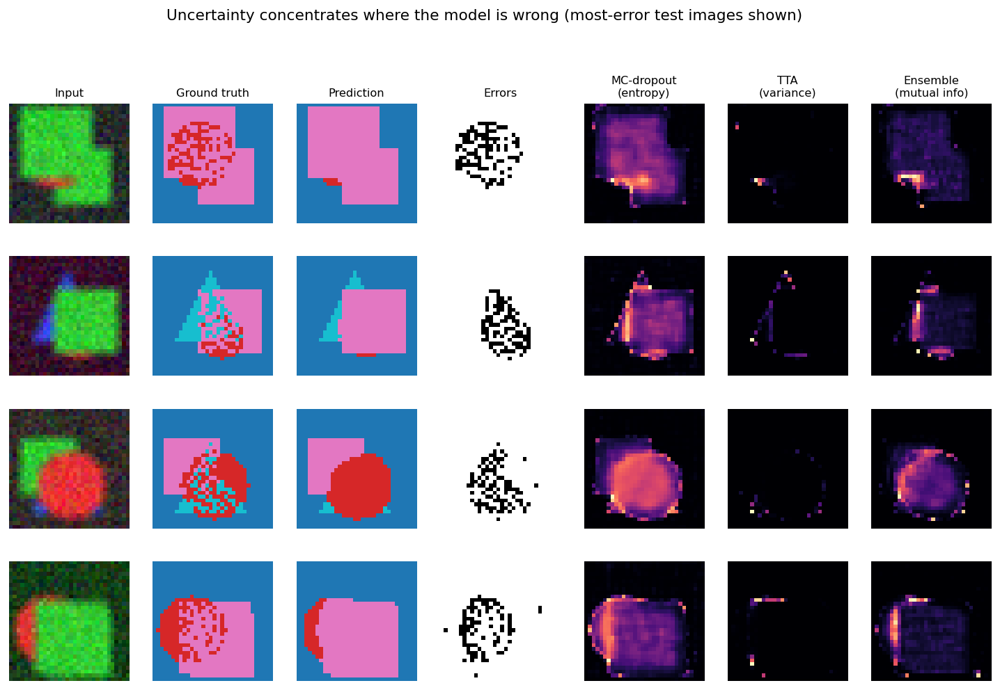

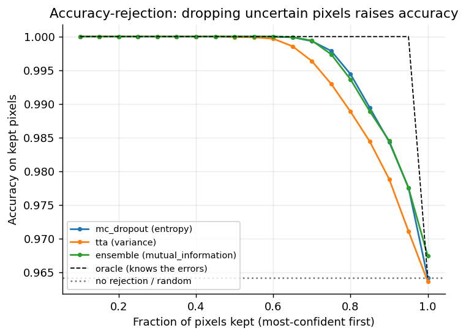

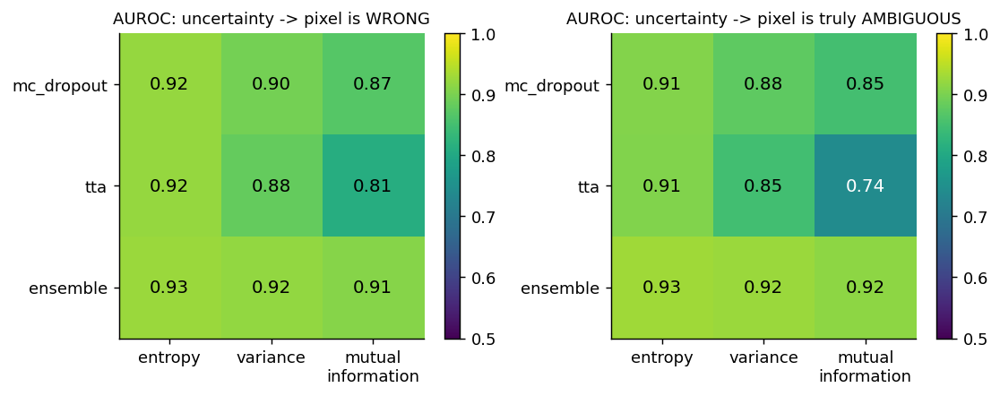

**Criteria (default uncertainty type of each method):**

- PASS -- mc_dropout/entropy: error_detection_auroc >= 0.75
- PASS -- mc_dropout/entropy: Q4 accuracy at least 5 points below Q1
- PASS -- mc_dropout/entropy: confident images more accurate than unconfident
- PASS -- tta/variance: error_detection_auroc >= 0.75
- PASS -- tta/variance: Q4 accuracy at least 5 points below Q1
- PASS -- tta/variance: confident images more accurate than unconfident
- PASS -- ensemble/mutual_information: error_detection_auroc >= 0.75
- PASS -- ensemble/mutual_information: Q4 accuracy at least 5 points below Q1
- PASS -- ensemble/mutual_information: confident images more accurate than unconfident

## 2. Does OOD detection separate shifted data from normal data?

AUROC of the detector score for 'shifted vs normal' held-out images (0.5 = chance). The leftmost severity of each family is *no shift* and is a control: it should be ~0.5. MSP / entropy are standard no-extra-model baselines (the model's own confidence); a useful OOD detector should beat them.

**Pixel noise (x std)**

| severity | Mahalanobis @conv1 | @conv2 | @conv3 | MSP baseline | entropy baseline | conv2 flagged is_ood |
|---|---|---|---|---|---|---|
| 1 (control) | 0.44 | 0.45 | 0.45 | 0.53 | 0.53 | 0% |
| 1.5 | 0.55 | 0.97 | 0.91 | 0.59 | 0.62 | 70% |
| 2 | 0.57 | 1.00 | 1.00 | 0.63 | 0.68 | 100% |
| 3 | 0.67 | 1.00 | 1.00 | 0.86 | 0.90 | 100% |
| 4 | 0.71 | 1.00 | 1.00 | 0.98 | 0.99 | 100% |
| 6 | 0.96 | 1.00 | 1.00 | 1.00 | 1.00 | 100% |
| 8 | 0.99 | 1.00 | 1.00 | 1.00 | 1.00 | 100% |

**Blur (kernel size)**

| severity | Mahalanobis @conv1 | @conv2 | @conv3 | MSP baseline | entropy baseline | conv2 flagged is_ood |
|---|---|---|---|---|---|---|
| 3 (control) | 0.44 | 0.45 | 0.45 | 0.53 | 0.53 | 0% |
| 5 | 0.58 | 0.73 | 0.84 | 0.75 | 0.76 | 13% |
| 7 | 0.64 | 0.90 | 0.98 | 0.76 | 0.77 | 44% |
| 9 | 0.65 | 0.97 | 1.00 | 0.77 | 0.76 | 68% |
| 13 | 0.80 | 1.00 | 1.00 | 0.63 | 0.60 | 95% |

**Color inversion (alpha)**

| severity | Mahalanobis @conv1 | @conv2 | @conv3 | MSP baseline | entropy baseline | conv2 flagged is_ood |
|---|---|---|---|---|---|---|
| 0.0 (control) | 0.44 | 0.45 | 0.45 | 0.53 | 0.53 | 0% |
| 0.25 | 0.42 | 0.99 | 1.00 | 0.95 | 0.93 | 92% |
| 0.5 | 0.50 | 1.00 | 1.00 | 0.99 | 0.98 | 98% |
| 0.75 | 0.53 | 1.00 | 1.00 | 0.95 | 0.92 | 97% |
| 1.0 | 0.65 | 1.00 | 1.00 | 0.95 | 0.88 | 99% |

**Qualitatively different inputs**

| input | @conv1 | @conv2 | @conv3 | MSP baseline | entropy baseline | conv2 flagged |
|---|---|---|---|---|---|---|
| Novel shapes (ring/cross, new color) | 0.65 | 1.00 | 1.00 | 0.94 | 0.86 | 100% |
| Pure noise images | 1.00 | 1.00 | 1.00 | 1.00 | 1.00 | 100% |

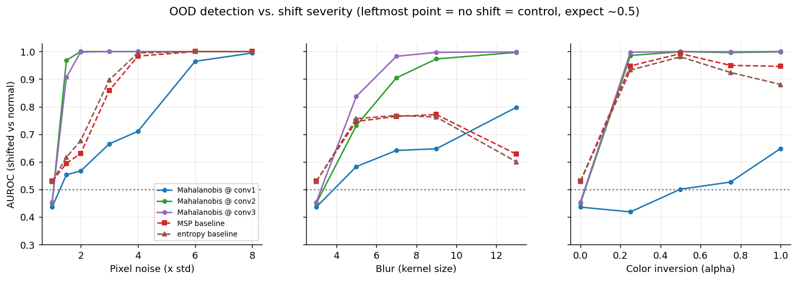

### False alarms on normal data vs. size of the fit set (the 0.6.0 threshold fix)

The detector's threshold is the 95th percentile of in-distribution scores, so ~5% of normal images should be flagged. Before 0.6.0 those scores were computed on the same images the Gaussian was fitted on (biased low); 0.6.0 cross-fits them.

| # fit images | 60 | 120 | 300 | 600 |
|---|---|---|---|---|
| in-sample (old) | 58.4% | 25.6% | 12.2% | 7.6% |
| cross-fit (new default) | 1.4% | 2.6% | 3.0% | 4.4% |

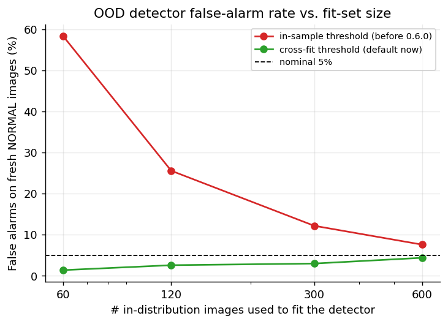

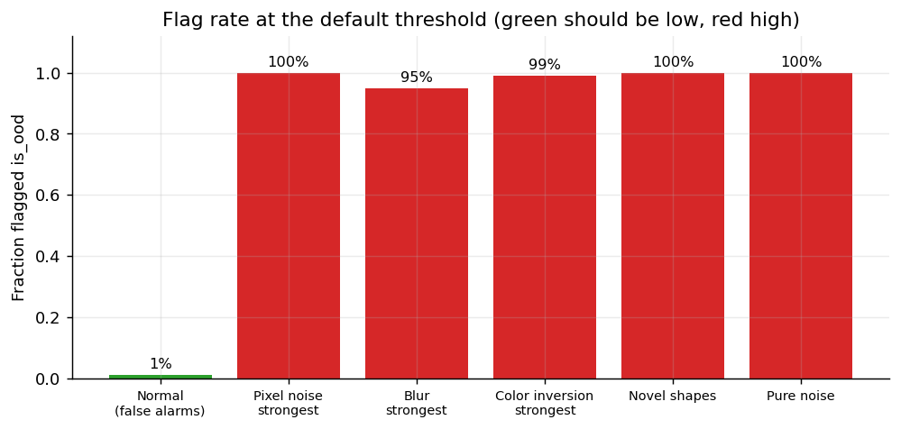

**Criteria:**

- PASS -- cross-fit threshold: false-alarm rate <= 7% (nominal 5%) at EVERY fit size from 60 to 600
- PASS -- cross-fit threshold is never worse than the in-sample one
- PASS -- false-positive rate on in-distribution data <= 10% (conv2)
- PASS -- control (no shift) AUROC within 0.4-0.6 for every family (conv2)
- PASS -- AUROC >= 0.9 at strongest shift for every family (conv2)
- PASS -- AUROC >= 0.9 on novel shapes and pure noise (conv2)
- PASS -- result.is_ood end-to-end: flags >= 80% of shifted, <= 15% of normal
- PASS -- is_ood batch output has one flag per image

## 3. Does temperature scaling fix overconfidence (and do no harm otherwise)?

The 'overconfident' model has 100% training accuracy on 32 noisy-label images and much lower accuracy on new data -- the usual way deep nets end up overconfident. ECE = Expected Calibration Error (lower is better).

| case | accuracy | mean confidence (raw) | learned T | ECE raw | ECE scaled | ECE reduction | NLL |
|---|---|---|---|---|---|---|---|
| Well-trained model | 96.3% | 95.4% | 0.97 | 0.0090 | 0.0073 | +19% | 0.122 -> 0.121 |
| Overconfident model | 82.9% | 96.3% | 2.22 | 0.1332 | 0.0712 | +47% | 1.389 -> 0.743 |
| Overconfident model under covariate shift | 61.4% | 94.4% | 2.22 | 0.3302 | 0.2600 | +21% | 3.398 -> 1.784 |

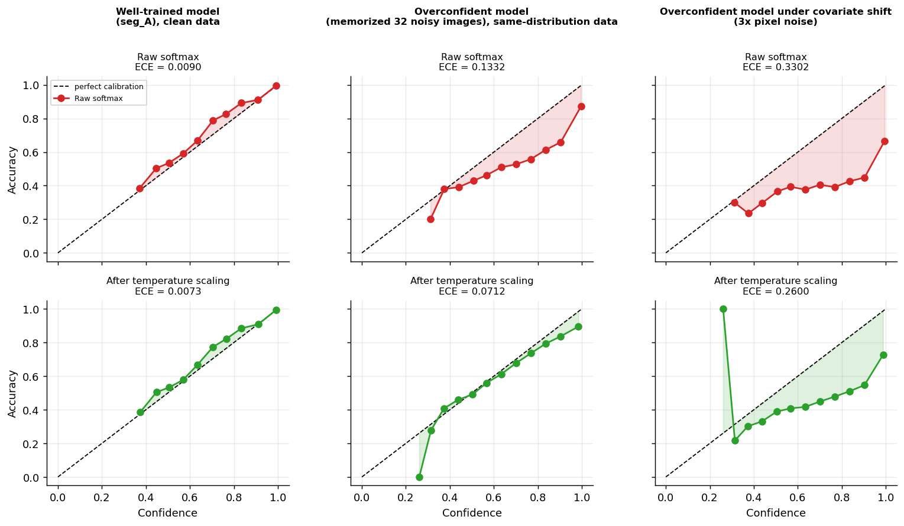

*(isolated points at the far-left of a curve are bins containing only a handful of pixels.)*

**Criteria:**

- PASS -- overconfident model: scaling cuts ECE by >= 30%
- PASS -- overconfident model: scaling lowers NLL
- PASS -- overconfident model: scaling raises T above 1 (softens confidence)
- PASS -- already-calibrated model: scaling does no harm (ECE rises < 0.005)
- PASS -- scaling never changes accuracy (argmax preserved)
- PASS -- under shift: scaling still reduces ECE

## 4. Conformal prediction: coverage, and do prediction sets adapt?

At target coverage 90% (alpha = 0.1). 'Overlap AUROC' = how well set size separates the *visibly ambiguous* shape-overlap pixels from the rest (0.5 = set size carries no information; a plain singleton prediction scores 0.5 by definition).

**Well-trained model (clean labels + overlap ambiguity)**

| score | coverage (target 90%) | mean set size (of 4) | singleton pixels | set size: overlap vs elsewhere | overlap AUROC |
|---|---|---|---|---|---|
| LAC | 96.4% | 1.00 | 100% | 1.00 vs 1.00 | 0.50 |
| APS | 99.7% | 1.80 | 43% | 2.64 vs 1.71 | 0.81 |
| RAPS (lam=0.01) | 98.9% | 1.27 | 74% | 1.97 vs 1.20 | 0.89 |
| RAPS (lam=0.1) | 96.7% | 1.02 | 98% | 1.11 vs 1.01 | 0.55 |

**Overconfident model (10% label noise + overlap ambiguity)**

| score | coverage (target 90%) | mean set size (of 4) | singleton pixels | set size: overlap vs elsewhere | overlap AUROC |
|---|---|---|---|---|---|
| LAC | 89.8% | 1.37 | 73% | 1.57 vs 1.35 | 0.58 |
| APS | 99.5% | 3.87 | 0% | 3.88 vs 3.87 | 0.50 |
| RAPS (lam=0.01) | 89.9% | 1.54 | 47% | 1.67 vs 1.53 | 0.57 |
| RAPS (lam=0.1) | 89.9% | 1.56 | 44% | 1.68 vs 1.54 | 0.57 |

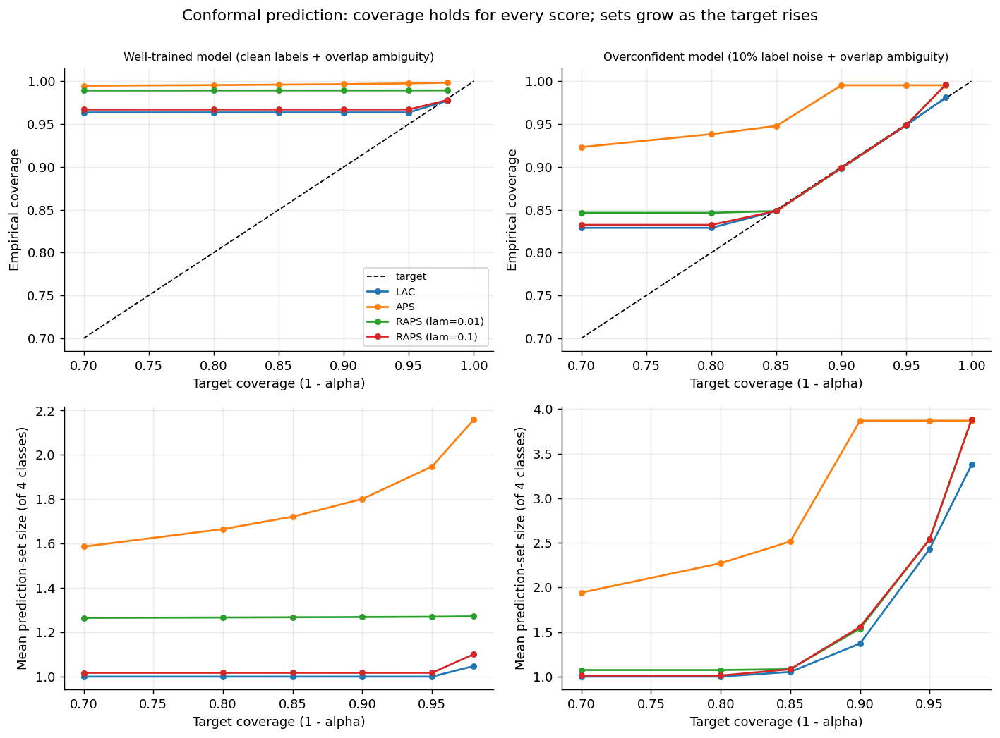

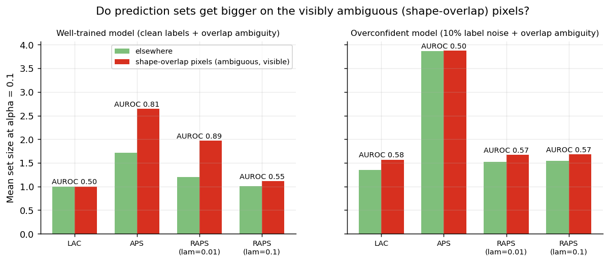

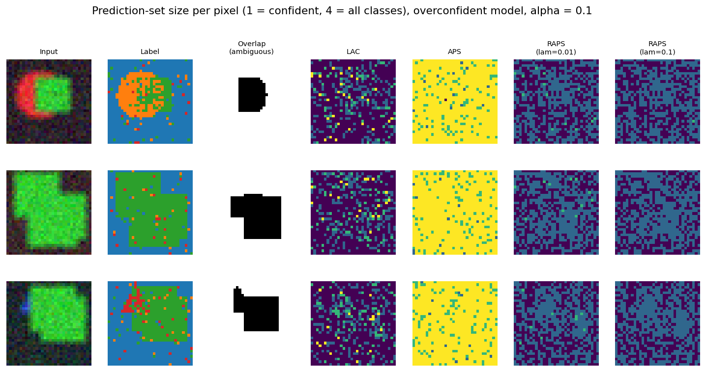

### Does calibrating the model first make the sets more informative?

Overconfident model, temperature T=2.22, alpha=0.1:

| model + score | coverage | mean set size | overlap AUROC |
|---|---|---|---|
| raw + lac | 89.8% | 1.37 | 0.58 |
| raw + aps | 99.5% | 3.87 | 0.50 |
| raw + raps | 89.9% | 1.54 | 0.57 |
| temperature_scaled + lac | 89.8% | 1.37 | 0.58 |
| temperature_scaled + aps | 95.1% | 2.58 | 0.54 |
| temperature_scaled + raps | 89.9% | 1.54 | 0.57 |

**Criteria:**

- PASS -- marginal coverage >= 1 - alpha - 0.01 for every case/score/alpha
- PASS -- smaller alpha never shrinks sets (every case/score)
- PASS -- every score returns >= 1 class per pixel (singleton fraction <= 1, size >= 1)

## 5. What changed since the PyPI release v0.2.1 (-> v0.6.0)

Identical experiments, identical model weights, run against both versions.

|  | v0.2.1 (old) | v0.6.0 (new) |
|---|---|---|
| Batch of 8 images -> results returned | 1 | 8 |
| Mean accuracy of returned mask vs each image's own ground truth | 66% | 97% |
| Dropout layer left in train mode after predict() | True | False |
| Max |difference| between two identical forward passes afterwards | 1.786 | 0.000 |
| OOD scores returned for a batch of 8 | 1 | 8 |
| Spread (std) of confidence for TTA + variance | 0.00030 | 0.00166 |

**Speed of mc_dropout predict() on one CPU core (ms, best of 3 medians):**

| input | old | new | old/new |
|---|---|---|---|
| 32x32, 20 samples | 12 | 10 | 1.23x |
| 64x64, 20 samples | 33 | 36 | 0.92x |
| 128x128, 20 samples | 127 | 139 | 0.91x |
| 256x256, 20 samples | 500 | 531 | 0.94x |

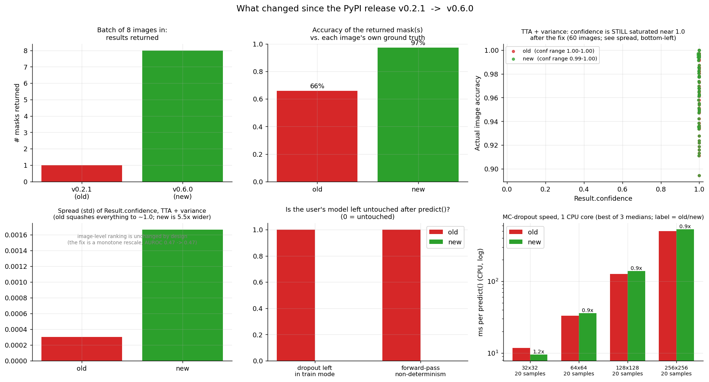

**Criteria:**

- PASS -- batch: new version returns one result per input image
- PASS -- batch: new version is accurate on every image, not just the first
- PASS -- variance confidence: values are less compressed than the old normalization (std >= 3x)
- PASS -- model state: new version leaves dropout in eval mode
- PASS -- model state: new version leaves forward passes deterministic
- PASS -- OOD batch: new version scores every image
- PASS -- speed: new MC-dropout is not slower than old at ANY tested input size (>= 0.9x)

## 6. What a user sees after `pip install` (clean venv, installed from the built wheel)

seggnosis 0.6.0 imported from `/home/claude/seggnosis_work/benchmarks/.cache/user_venv/lib/python3.12/site-packages/seggnosis/__init__.py`; Python 3.12.3, torch 2.14.1+cu130, linux.

| ID | Scenario | Result | Observed |
|---|---|---|---|
| S01 | Installation looks like a normal pip install | PASS | v0.6.0 from /home/claude/seggnosis_work/benchmarks/.cache/user_venv/lib/python3.12/site-packages/seggnosis; pip check clean; cold import incl. torch 2.71s |
| S02 | README quickstart: wrap(...).predict(image) | PASS | mask(32, 32) probs(4, 32, 32); confidence=0.923 mean_uncertainty=0.106 |
| S03 | Every method x every uncertainty type runs | PASS | 9/9 combinations OK |
| S04 | Batch of images | PASS | mask(5, 32, 32) confidence(5,); identical to per-image predictions |
| S05 | 3-D volumes (spatial_dims=3) | PASS | mc_dropout, tta, ensemble OK on single and batched volumes |
| S06 | OOD detection through result.is_ood | PASS | false alarms 7%, shifted detected 100%; save/load round-trip identical |
| S07 | Temperature scaling on an overconfident model | PASS | T=2.22; ECE 0.1332 -> 0.0712 (47% lower) |
| S08 | Conformal prediction (LAC / APS / RAPS) | PASS | lac: cov 0.961, size 1.00; aps: cov 0.996, size 1.78; raps: cov 0.988, size 1.26 / error before calibrate: "Call .calibrate(calibration_data) before .predict() -- the conformal t..." |
| S09 | Whole-image classification API | PASS | mc_dropout->class 3; tta->class 3; ensemble->class 3; OOD attached OK |
| S10 | Mistakes produce clear, specific error messages | PASS | 13/13 misuse cases raise a clear error |
| S11 | The user's model is left untouched by predict() | PASS | mode, weights and grads unchanged for 4 methods x {eval, train} starting states |
| S12 | Determinism | PASS | tta/ensemble identical across calls; mc_dropout differs between calls, identical with torch.manual_seed |
| S13 | Documentation is present | PASS | all 12 public names documented |
| S14 | Visualization helpers produce figures | PASS | user_mask_comparison.png, user_overlay.png written |
| S15 | Typical latency on CPU (informational) | PASS | cuda available: False; 32x32 mc_dropout: 9 ms; 32x32 tta: 3 ms; 32x32 ensemble: 2 ms; 64x64 mc_dropout: 37 ms; 64x64 tta: 8 ms; 64x64 ensemble: 6 ms |

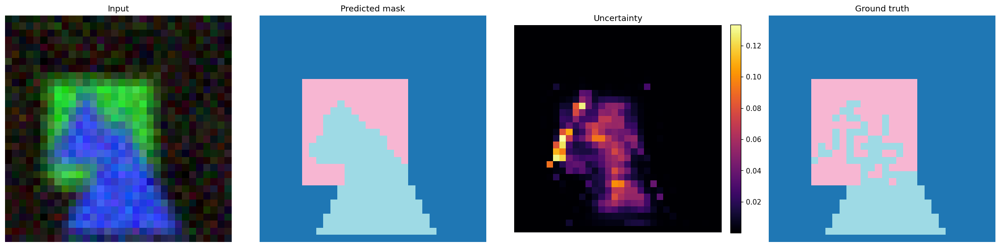

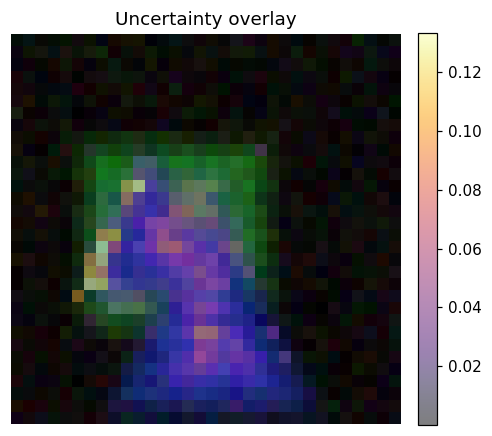

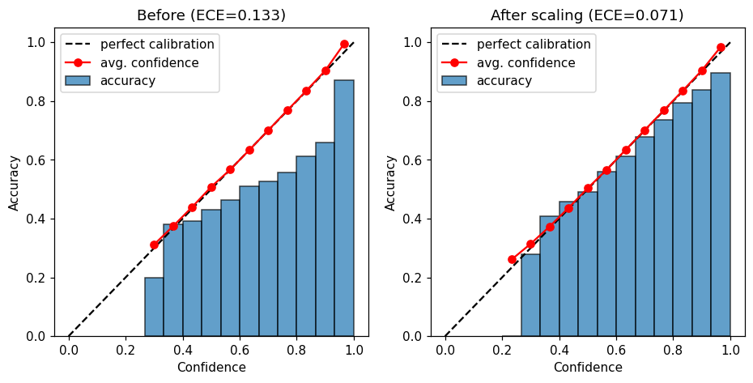

Full transcript: [user_simulation/transcript.txt](user_simulation/transcript.txt)

## What this does NOT show

- **No real data.** Everything is a synthetic shapes task. Real images have richer structure, real distribution shifts (scanner, site, protocol) and real annotation noise. Run `benchmarks/run_all.py`-style checks on a held-out slice of your own data before relying on any number here.
- **Tiny model, CPU only.** No GPU timing was measured; the batched-replication speed behaviour on CUDA is untested.
- **OOD detection** was tested on covariate shift (noise, blur, color) and one novel-shape case. Subtle semantic shift on real data is the hard case and is not covered.
- **3-D volumes** are only smoke-tested (shapes and API), not validated for uncertainty quality.
- **Conformal coverage** is a *pooled-over-pixels* guarantee (neighbouring pixels are not exchangeable); per-image coverage varies.
- Thresholds in the criteria are the author's choices; different reasonable choices would change some PASS/FAIL marks.
